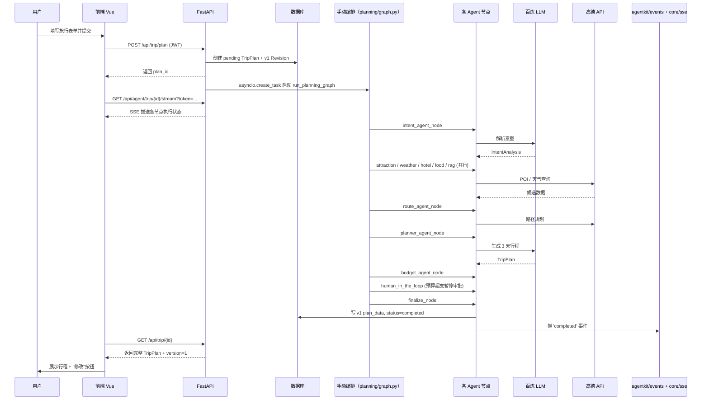

# agent1旅行 — 项目结构与实现说明

> 本文档从整体视角介绍 `agent1旅行` 项目的目录结构、关键文件职责，以及核心功能是如何串联实现的。
>
> **项目当前状态**：已完成 MVP，主要功能包括智能行程规划、实时进度推送、用户反馈与重新生成、版本管理、长期记忆等。本文档反映 2026-10 的代码现状（近期完成了一轮目录重构：后端 models/agents/tasks 按职责拆分，前端 views/api 按域分组；随后完成后端七层架构重构：api/tasks → planning → services → travel → agentkit → rag/llm → core/models）。

## 零、写给新同学的一段话

如果你第一次接触这个项目，先用 5 分钟看明白这几件事：

1. **整个项目分前后端两块**——`backend/` 是 Python（FastAPI），`frontend/` 是 Vue 3。前端调用后端的 REST 接口，复杂任务（行程规划）通过 SSE（Server-Sent Events）实时推日志。
2. **后端按七层单向依赖组织**（api/tasks → planning → services → travel → agentkit → rag/llm → core/models）：
   - **API 层**（`app/api/routes/`）：HTTP 接口，负责收请求和返回响应
   - **编排层**（`app/planning/`）：11 个 AI 节点串起来跑（图编排 + 节点 + 工具）
   - **服务层**（`app/services/`）：业务逻辑，比如调高德、RAG 门面
   - **框架层**（`app/agentkit/`）：批次执行、事件总线、审批、提示词加载等 Agent 框架能力
   - **LLM 层**（`app/llm/`）：百炼 LLM 客户端封装
   - **数据层**（`app/core/db/` + `app/models/`）：SQLAlchemy 异步 ORM + Pydantic 校验
3. **核心数据表就 3 张**：
   - `trip_plans` — 行程主表
   - `plan_revisions` — 同一个行程的多个版本（v1/v2/v3）
   - `plan_feedbacks` — 用户对行程提的反馈
4. **核心功能走完要经过 11 个节点**——从 `intent_agent` 一直跑到 `finalize_node`，详见第五章 5.4 节。
5. **用户提反馈 → 重新生成是核心亮点**——这是项目最有意思的部分，详见第五章 5.7 节。

详细的目录结构看第二节；文件职责看第三、四节；核心流程看第五节。

---

## 一、项目定位与技术栈

`agent1旅行` 是一个基于 **LangGraph 概念 + FastAPI + Vue 3** 的智能旅行规划系统。用户填写旅行需求后，系统由多个 Agent 协作完成意图理解、景点检索、酒店推荐、路线规划、预算统计等任务，最终生成可导出的行程计划。

| 层级 | 主要技术 |
|------|---------|
| 前端 | Vue 3 + TypeScript + Vite + Pinia + Vue Router + Ant Design Vue + Axios + 高德 JSAPI |
| 后端 | FastAPI + SQLAlchemy（async）+ JWT + Pydantic v2 |
| Agent 框架 | LangChain（LLM 调用、消息抽象）+ **手动顺序节点编排**（参考 LangGraph 状态图模型） |
| 大模型 | 阿里云百炼（通过 `app/llm/client.py` 统一封装） |
| 地图服务 | 高德地图 JSAPI / Web API（POI 搜索、天气、路线规划） |
| 知识库 | 百度百科（背景知识）+ 可选 Qdrant 向量库（RAG） |
| 支付 | 支付宝 / 微信沙箱 SDK（模拟真实支付流程） |

> **关于"LangGraph"**：项目早期用 LangGraph 0.2.x 的 `ainvoke()` 跑全流程，因 Checkpointing 序列化 Pydantic 对象图卡死（见 [问题排查记录.md 问题 1](file:///d:/agent1/docs/问题排查记录.md)），后改为**手动顺序 `await` 调用节点 + 合并状态**。模型仍按 LangGraph 的 StateGraph 设计（State、Node、Edge），但执行层是手写。

---

## 二、目录结构

```text
agent1旅行/
├── backend/                     # 后端服务
│   ├── app/
│   │   ├── planning/            # 编排层：Agent 图编排
│   │   │   ├── graph.py         # 图构建（节点/边注册）+ 多城联游编排；run_planning_graph / run_revision_graph / run_recalculate_graph 入口
│   │   │   ├── state.py         # TravelPlanningState 共享状态
│   │   │   ├── agents/          # 各 Agent 节点函数（一个节点一个文件，原 agents/nodes/ 上移至此）
│   │   │   │   ├── intent.py / attraction.py / weather.py / hotel.py
│   │   │   │   ├── food.py / rag.py / route.py / planner.py
│   │   │   │   ├── budget.py / patch.py / finalize.py
│   │   │   │   └── _helpers.py  # 节点间共享的辅助函数
│   │   │   └── tools/           # 高德 POI / 天气 / 路线 / RAG / 酒店等工具封装（amap_tools.py 等）
│   │   ├── agentkit/            # Agent 框架层
│   │   │   ├── executor.py      # 批次执行核心（NodeFunc / _merge_update / _run_node / _run_batches，批次执行器已上移框架层）
│   │   │   ├── events.py        # 事件总线（实时日志）
│   │   │   ├── context.py / checkpoint.py / approval.py / skills.py
│   │   │   ├── tool_registry.py / memory.py
│   │   │   └── prompt_loader.py # 惰性加载 workspace/prompts/*.md 提示词（改 md 即生效）
│   │   ├── llm/                 # LLM 层
│   │   │   └── client.py        # 百炼 LLM 统一封装（get_llm）
│   │   ├── api/                 # REST API 路由
│   │   │   ├── main.py          # FastAPI 应用入口
│   │   │   ├── deps.py          # JWT 鉴权依赖
│   │   │   └── routes/
│   │   │       ├── auth.py      # 注册、登录、当前用户
│   │   │       ├── user.py / profiles.py / friends.py    # 用户信息、资料、好友
│   │   │       ├── trip/        # 行程域接口：plans / plan_detail / feedback / revisions / chat / today / journal / archive / checkins / favorites / recommendations / notifications
│   │   │       ├── agent.py     # SSE 实时日志推送
│   │   │       ├── map.py / poi.py / search.py           # 高德地图代理、POI、搜索
│   │   │       ├── rag.py / memory.py / crawler.py       # 知识库、偏好记忆、爬虫
│   │   │       ├── community.py / journals.py / guides.py # 社区、游记、攻略
│   │   │       ├── collab.py / messaging.py              # 多人协作、私信
│   │   │       └── payment.py / upload.py / admin.py     # 沙箱支付、上传、后台管理
│   │   ├── core/                # 核心层
│   │   │   ├── config.py        # 全局配置（pydantic-settings）
│   │   │   ├── sse.py           # SSE 传输
│   │   │   ├── db/              # 数据库层：base.py（Base 模型）/ session.py（AsyncSessionLocal）/ init_db.py（表初始化）
│   │   │   └── utils/           # security / json_parser / validators / logger / queue
│   │   ├── models/              # Pydantic Schema + SQLAlchemy ORM（按域拆分）
│   │   │   ├── db_user.py / db_trip.py / db_community.py / db_order.py / db_misc.py
│   │   │   ├── db_models.py     # 兼容垫片：显式 __all__ re-export，外部 import 路径不变
│   │   │   ├── schema_common.py / schema_user.py / schema_trip.py
│   │   │   ├── schema_collab.py / schema_social.py / schema_misc.py
│   │   │   └── schemas.py       # 兼容垫片：同上
│   │   ├── services/            # 业务服务
│   │   │   ├── amap_service.py  # 高德 Web API 封装
│   │   │   ├── auth_service.py  # JWT、密码哈希
│   │   │   ├── memory_service.py# 偏好/版本/反馈/记忆 CRUD
│   │   │   ├── rag_service.py   # 向量检索 + 搜索优先 + 外部搜索联动
│   │   │   ├── baike_service.py # 百度百科外部搜索（兜底 RAG 数据源）
│   │   │   ├── crawler_service.py# 爬虫调度
│   │   │   ├── payment_service.py# 沙箱支付
│   │   │   ├── trip_task_service.py  # arq 任务的业务逻辑（规划/修订/重算/天气检查/游记生成）
│   │   │   ├── plan_persist_service.py # 行程状态落库（completed/failed 收尾）
│   │   │   └── ws_manager.py / notification_service.py / replicate_service.py
│   │   ├── tasks.py             # 6 个 arq 任务函数（薄壳，业务逻辑下沉到 services/trip_task_service.py）
│   │   └── __init__.py
│   ├── scripts/
│   │   └── check_layers.py      # 分层依赖检查脚本（AST 检查禁止反向 import）
│   ├── ruff.toml                # Ruff lint 配置
│   ├── worker.py                # ARQ Worker 启动入口（消费 Redis 任务队列）
│   ├── .env / .env.example      # 环境变量
│   ├── requirements.txt         # Python 依赖
│   ├── agent1travel.db          # SQLite 数据库
│   └── run.py                   # 启动入口
├── frontend/                    # 前端应用
│   ├── src/
│   │   ├── api/                 # 后端接口封装（按域分组）
│   │   │   ├── request.ts       # Axios 实例 + JWT 拦截器（留在根）
│   │   │   ├── auth/index.ts    # 登录/注册
│   │   │   ├── trip/            # index.ts（行程主接口）+ agent / map / collab / payment / knowledge / memory / recommend / companion.ts
│   │   │   ├── community/       # index.ts + guides.ts / search.ts
│   │   │   ├── social/          # index.ts + notification.ts
│   │   │   └── admin/index.ts   # 后台管理接口
│   │   ├── components/          # 可复用组件（AgentLogPanel / PlanCard / PlanMap / MapContainer / BudgetCharts / CommunityRail 等）
│   │   ├── router/index.ts      # 路由 + 全局守卫（26 个页面全部懒加载，按域分组注释）
│   │   ├── stores/              # Pinia：auth.ts（用户状态）、notify.ts（消息通知）
│   │   ├── views/               # 页面级组件（按域分组）
│   │   │   ├── auth/            # Login, Register
│   │   │   ├── trip/            # Home, Planning, Result(+Result/ 子组件), SharedPlan, Join, Pay, Orders, Today, Footprints, Journal, Archive
│   │   │   ├── community/       # Circle, PostDetail, Guides, GuideDetail, Destination, Search, Creators, JournalShare
│   │   │   ├── social/          # Messages(+Messages/ 子组件), UserProfile
│   │   │   ├── profile/         # Profile, Favorites
│   │   │   └── admin/           # Admin.vue + 4 个 Admin*.vue 子面板
│   │   ├── styles/design-system.css
│   │   ├── App.vue / main.ts / env.d.ts / router-meta.d.ts
│   ├── eslint.config.js         # ESLint 配置
│   ├── .prettierrc / .prettierignore  # 格式化配置
│   ├── index.html
│   ├── package.json             # 依赖与脚本（含 lint / format）
│   ├── tsconfig.json / tsconfig.node.json
│   └── vite.config.ts
└── docs/                        # 项目文档
    ├── 项目计划.md               # 立项时写的设计文档
    ├── 项目结构与实现说明.md      # 本文档
    ├── 项目改进计划.md           # 改进记录（按版本倒序）
    ├── 问题排查记录.md           # 棘手问题排查
    ├── RAG架构说明.md            # RAG 知识库架构详解
    ├── 部署文档.md / 系统适配说明.md / 项目实战作品介绍.md / 项目阅读.md
    └── agent/ backend/ frontend/  # 各模块深入说明
```

---

## 三、后端文件职责

### 3.1 `app/planning/` + `app/agentkit/` — Agent 编排与框架

| 文件 | 职责 |
|------|------|
| `planning/state.py` | `TravelPlanningState`（TypedDict 共享状态），含请求、意图、景点/酒店/天气、路线矩阵、RAG 上下文、候选方案、最终方案、日志、错误等 |
| `planning/tools/` | 外部工具封装（`amap_tools.py` 等）：高德 POI 搜索、天气、路线、RAG 检索、酒店搜索 |
| `planning/agents/` | **11 个节点函数**（一个节点一个文件）：`intent.py`、`attraction.py`、`weather.py`、`hotel.py`、`food.py`、`rag.py`、`route.py`、`planner.py`、`budget.py`、`patch.py`、`finalize.py`，公共辅助在 `_helpers.py` |
| `planning/graph.py` | **图构建 + 编排入口**：节点/边注册（`get_planning_graph`）、多城联游编排（`split_cities_node` / `city_gather_node` / `route_multi_node`），对外提供 `run_planning_graph`（首次规划）、`run_revision_graph`（基于反馈重新生成，支持 patch/full 双路径）、`run_recalculate_graph`；行程状态落库收尾在 `services/plan_persist_service.py` |
| `agentkit/executor.py` | **批次执行核心**：`NodeFunc` 类型、`_merge_update`、`_run_node`、`_run_batches`——按批次顺序/并行执行节点并合并状态（批次执行器已上移框架层） |
| `agentkit/events.py` | 事件总线：每个 `plan_id` 维护历史 + 实时事件流，SSE 传输层（`core/sse.py`）从中读取 |
| `agentkit/prompt_loader.py` | 惰性加载外置提示词 `backend/workspace/prompts/*.md`（改 md 即生效），各 Agent 的系统/用户提示词按文件分块管理 |
| `agentkit/checkpoint.py` / `approval.py` 等 | 断点 checkpoint、M3 审批暂停/恢复协议，以及 context / skills / tool_registry / memory 等框架能力 |

### 3.2 `app/api/` — REST API 层

| 文件 | 职责 |
|------|------|
| `main.py` | FastAPI 应用实例 + CORS + 全局异常 + 路由注册 |
| `deps.py` | `get_current_user` 等鉴权依赖 |
| `routes/auth.py` | `/register` `/login` `/me` |
| `routes/trip/` | **核心**（行程域接口按功能拆分）：`plans.py` 创建、`plan_detail.py` 查询、`feedback.py` 反馈、`revisions.py` 版本历史/重新生成、`chat.py` 行程对话、`today.py` 当日行程、`journal.py` / `archive.py` 游记归档、`checkins.py` 打卡、`favorites.py` 收藏、`recommendations.py` 推荐、`notifications.py` 通知 |
| `routes/agent.py` | SSE 实时推送 Agent 执行日志（`/api/agent/trip/{id}/stream`） |
| `routes/map.py` | 高德地图 POI、天气、路线代理 |
| `routes/poi.py` | POI 详情/图片 |
| `routes/search.py` | 全局搜索 |
| `routes/rag.py` | 知识库上传/检索 |
| `routes/crawler.py` | 触发爬虫采集攻略 |
| `routes/memory.py` | 用户偏好记忆 |
| `routes/payment.py` | 沙箱支付订单 |
| `routes/community.py` / `journals.py` / `guides.py` | 社区、游记、攻略 |
| `routes/collab.py` / `messaging.py` | 多人协作、私信 |
| `routes/user.py` / `profiles.py` / `friends.py` | 用户信息、资料、好友 |
| `routes/upload.py` / `admin.py` | 文件上传、后台管理 |

### 3.3 `app/models/` — 数据模型

模型按域拆分为多个文件；原 `db_models.py` 与 `schemas.py` 保留为显式 `__all__` re-export 兼容垫片，**外部 `from app.models.db_models import ...` / `from app.models.schemas import ...` 的写法不受影响**。数据库表总数不变（21 张）。

| 文件 | 职责 |
|------|------|
| `schema_common.py` / `schema_user.py` / `schema_trip.py` / `schema_collab.py` / `schema_social.py` / `schema_misc.py` | Pydantic v2 模型按域拆分：`TripRequest`、`TripPlan`、`IntentAnalysis`、`Budget`、`DayPlan`、`Attraction`、`Hotel`、`Meal`、`WeatherInfo`、`StructuredFeedback`、`PlanFeedbackRequest/Response`、`RevisionSummary` 等 |
| `db_user.py` / `db_trip.py` / `db_community.py` / `db_order.py` / `db_misc.py` | SQLAlchemy 异步 ORM 模型按域拆分：`User`、`TripPlanDB`、`PlanRevision`、`PlanFeedback`、`UserPreferenceDB`、`UserMemory`、`Payment`、`Order` 等 |
| `schemas.py` / `db_models.py` | 兼容垫片：集中 re-export 各域模型，保持旧 import 路径可用 |

#### 核心数据库表

| 表 | 关键字段 | 用途 |
|---|---|---|
| `users` | `username`、`email`、`password_hash` | 用户账号 |
| `trip_plans` | `id`、`user_id`、`city`、`start_date`、`end_date`、`status`、`plan_data` | 行程主表 |
| `plan_revisions` | `plan_id`、`version`、`source (initial/full/patch)`、`trip_plan_json`、`diff_summary`、`is_current` | **版本历史**——同 plan 可有 v1/v2/v3，新版本自动作废旧版本 |
| `plan_feedbacks` | `plan_id`、`revision_id`、`user_id`、`day_index`、`raw_text`、`tags`、`structured_feedback`、`is_withdrawn` | 用户对某天提的反馈 |
| `user_preferences` | `user_id`、`budget_level`、`favorite_tags`、`disliked_tags`、`food_taste`、`price_sensitivity`、`travel_pace` | **结构化偏好** |
| `user_memories` | `user_id`、`event_type`、`payload` | **事件级记忆**（feedback / preference / visit） |
| `payments` | `id`、`user_id`、`plan_id`、`amount`、`status`、`payment_method` | 沙箱支付订单 |

### 3.4 `app/services/` — 业务服务

> 百炼 LLM 封装已上移至 `app/llm/client.py`（`get_llm`），不在 services 层。

| 文件 | 职责 |
|------|------|
| `amap_service.py` | 封装高德 Web API（POI 搜索、地理编码、天气、路径规划） |
| `auth_service.py` | 用户密码哈希、JWT、用户信息转换 |
| `memory_service.py` | **核心**——版本链管理、反馈聚合 (`aggregate_active_feedbacks`)、偏好读写、episodic 记忆、Qdrant 同步 |
| `rag_service.py` | 向量库（Qdrant）写入/检索、Embedding 编码、`search_or_fetch` 联动外部搜索 |
| `baike_service.py` | 百度百科外部搜索（兜底 RAG 数据源） |
| `crawler_service.py` | 调度爬虫抓取攻略网页并写入知识库 |
| `payment_service.py` | 支付宝 / 微信沙箱订单创建与状态查询 |
| `trip_task_service.py` | **arq 后台任务的业务逻辑**（从原 tasks.py 下沉）：修订锁与状态管理、天气复核触发修订、游记生成等 |
| `plan_persist_service.py` | 行程状态落库收尾（`mark_plan_completed` / `mark_plan_failed`，从原 graph.py 拆出） |
| `ws_manager.py` / `notification_service.py` / `replicate_service.py` | WebSocket 连接管理、站内通知、内容复制/转发服务 |

### 3.5 `app/core/db/` — 数据库层

| 文件 | 职责 |
|------|------|
| `base.py` | `Base` + `BaseModelMixin`（id, created_at, updated_at） |
| `session.py` | 异步 SQLAlchemy 引擎 + `AsyncSessionLocal` + `get_db` |
| `init_db.py` | 表初始化 |

### 3.6 `app/core/utils/` — 通用工具

| 文件 | 职责 |
|------|------|
| `security.py` | JWT 编码/解码、密码哈希验证 |
| `json_parser.py` | **关键**——LLM JSON 容错解析：第一次 strict、第二次宽松、第三次 `_replace_none_with_defaults` 兜底 |
| `validators.py` | 手机号、邮箱、日期等通用校验 |
| `logger.py` | Loguru 按天滚动日志 |
| `queue.py` | ARQ 队列封装 |

### 3.7 任务队列与后端根文件

| 文件 | 职责 |
|------|------|
| `app/tasks.py` | 6 个 arq 任务函数薄壳：`run_planning_task` / `run_revision_task` / `run_recalculate_task` / `run_crawler_task` / `run_weather_check_task` / `run_journal_task`，函数名与签名保持稳定，业务逻辑在 `services/trip_task_service.py` |
| `worker.py` | ARQ Worker 启动入口，消费 Redis 任务队列 |
| `app/core/config.py` | `pydantic-settings` 读取 `.env` |
| `run.py` | `uvicorn` 启动 FastAPI |
| `ruff.toml` | Ruff lint 配置 |
| `scripts/check_layers.py` | 分层依赖检查脚本（AST 检查七层单向依赖，禁止反向 import） |
| `.env.example` | 环境变量模板 |
| `requirements.txt` | Python 依赖 |

---

## 四、前端文件职责

### 4.1 工程配置
| 文件 | 职责 |
|------|------|
| `vite.config.ts` | Vite 配置、端口 5173、路径别名 `@ -> src` |
| `tsconfig.json` / `tsconfig.node.json` | TypeScript 配置 |
| `package.json` | 依赖与脚本（新增 `lint` / `format` scripts） |
| `eslint.config.js` | ESLint 配置（vue + typescript-eslint） |
| `.prettierrc` / `.prettierignore` | Prettier 格式化配置 |
| `index.html` | 单页应用挂载容器 |

### 4.2 入口与根组件
| 文件 | 职责 |
|------|------|
| `src/main.ts` | 创建 Vue 应用，注册 Pinia、Vue Router、Ant Design Vue |
| `src/App.vue` | 全局布局（顶部导航、登录状态）、`router-view` 出口 |
| `src/env.d.ts` | 声明 `import.meta.env`、扩展 `RouteMeta` |

### 4.3 路由与状态
| 文件 | 职责 |
|------|------|
| `src/router/index.ts` | 路由表 + 全局守卫，非公开页面校验登录；26 个页面全部懒加载 `() => import('@/views/域/Xxx.vue')`，按域分组注释 |
| `src/stores/auth.ts` | Pinia Store：token、用户信息、login/register/logout |
| `src/stores/notify.ts` | Pinia Store：站内消息/通知状态 |

### 4.4 API 封装（按域分组）
| 文件 | 职责 |
|------|------|
| `src/api/request.ts` | Axios 实例：基地址、JWT 拦截器、统一错误提示（留在根） |
| `src/api/auth/index.ts` | 登录/注册/me |
| `src/api/trip/index.ts` | 行程创建/查询/反馈/版本/重新生成 |
| `src/api/trip/agent.ts` | SSE 实时日志连接 |
| `src/api/trip/map.ts` | POI/天气/路线 |
| `src/api/trip/` 其余 | collab / payment / knowledge / memory / recommend / companion 等分域封装 |
| `src/api/community/` | index.ts + guides.ts / search.ts |
| `src/api/social/` | index.ts + notification.ts |
| `src/api/admin/index.ts` | 后台管理接口 |

### 4.5 页面组件（按域分组，共 26 个页面）
| 目录 | 页面 |
|------|------|
| `views/auth/` | `Login.vue`（登录）、`Register.vue`（注册） |
| `views/trip/` | `Home.vue`（规划表单）、`Planning.vue`（SSE 进度页）、`Result.vue`（**核心**结果页）、`SharedPlan.vue`、`Join.vue`、`Pay.vue`、`Orders.vue`、`Today.vue`、`Footprints.vue`、`Journal.vue`、`Archive.vue` |
| `views/community/` | `Circle.vue`、`PostDetail.vue`、`Guides.vue`、`GuideDetail.vue`、`Destination.vue`、`Search.vue`、`Creators.vue`、`JournalShare.vue` |
| `views/social/` | `Messages.vue`（私信）、`UserProfile.vue` |
| `views/profile/` | `Profile.vue`（个人中心）、`Favorites.vue` |
| `views/admin/` | `Admin.vue`（后台管理入口，子面板在 `Admin*.vue`） |

> 三个原本上千行的巨型组件已拆分：`Result.vue` 的子组件在 `views/trip/Result/`，`Messages.vue` 的子组件在 `views/social/Messages/`，`Admin.vue` 的子面板在 `views/admin/` 同目录。

### 4.6 可复用组件
| 文件 | 职责 |
|------|------|
| `AgentLogPanel.vue` | 接收 `logs` 数组，按时间线展示 Agent 节点执行 |
| `PlanCard.vue` | 行程卡片 |
| `MapContainer.vue` | 高德地图容器 |
| `PlanMap.vue` | 行程地图（含路线） |
| `BudgetCharts.vue` | 预算/花费图表 |
| `CommunityRail.vue` / `NoteComposerModal.vue` / `PublishCommunityModal.vue` / `PreferenceCard.vue` | 社区侧栏、笔记/社区发布弹窗、偏好卡片 |

---

## 五、核心功能实现流程

### 5.1 整体时序



### 5.2 用户认证流程

1. **注册**：`Register.vue` → `api/auth/index.ts` → `/auth/register` → 写 `users` 表
2. **登录**：`Login.vue` → `authStore.login` → 保存 `access_token` 到 `localStorage` + `/auth/me` 拉用户信息
3. **鉴权**：`request.ts` 拦截器自动加 `Authorization: Bearer <token>`；后端 `deps.py` 校验 JWT
4. **SSE 特殊处理**：`EventSource` 不能加 Header，前端在 URL `?token=`，后端 `agent.py` 的 `_get_current_user_for_sse` 兼容 Query Token 和 Header Token

### 5.3 规划任务启动流程

1. 用户在 `views/trip/Home.vue` 填表单
2. `createPlan` → `POST /api/trip/plan`
3. 后端生成 `plan_id`，在 `trip_plans` 创建 `pending` 记录 + 在 `plan_revisions` 创建 v1（source=initial）
4. 通过 ARQ 队列投递 `run_planning_task`（`app/tasks.py`），Worker 进程消费执行，接口立即返回

### 5.4 手动编排（graph.py）

早期用 LangGraph 0.2.x 的 `ainvoke()` 跑全流程，因 Checkpointing 序列化 Pydantic 对象图卡死（见 [问题排查记录.md 问题 1](file:///d:/agent1/docs/问题排查记录.md)），后改为**手动顺序 `await` 调用节点**：

```python
# 伪代码（实际在 graph.py run_planning_graph）
state = initial_state_from_request(request)
for node in [intent_agent, attraction_agent, weather_agent,
             hotel_agent, food_agent, rag_agent, route_agent,
             planner_agent, budget_agent, human_in_the_loop, finalize]:
    update = await node(state)
    state.update(update)
    streaming.publish(plan_id, node.__name__, update)
return state
```

#### 11 个节点

| 节点 | 职责 |
|------|------|
| `intent_agent_node` | 解析用户输入为结构化 `IntentAnalysis`（城市/日期/天数/交通/住宿/偏好/必去景点/预算） |
| `attraction_agent_node` | 调高德 POI 搜景点，限制 ≤ 10 个，并发 RAG 补背景 |
| `weather_agent_node` | 查旅行期间天气 |
| `hotel_agent_node` | 按住宿类型+预算+景点区域推荐酒店 |
| `food_agent_node` | 搜三餐候选餐厅 |
| `rag_agent_node` | Qdrant 检索城市攻略、避坑建议 |
| `route_agent_node` | 调高德路径规划算景点间距离+时间（**`asyncio.gather` 并行**，否则 24×23=552 次 API 串行调 10 分钟） |
| `planner_agent_node` | LLM 生成 3 天行程；prompt 摘要机制（**23K → 5K 字符**） |
| `budget_agent_node` | 统计门票/餐饮/酒店/交通分项预算 |
| `human_in_the_loop` | M3 真 HITL：预算超支时暂停置 `pending_approval`，经 `POST /api/trip/{plan_id}/approve` 审批后从断点续跑；未超支直接通过 |
| `finalize_node` | 算 `diff_summary`（相对上一版本）、写 `plan_data`、状态 `completed`、SSE 推完成 |

### 5.5 实时进度推送（SSE）

1. 前端进 `Planning.vue` 后调 `streamAgentLogs(planId)` 建 SSE 连接
2. 后端 `agent.py` 的 `stream_agent_events` 从 `app/core/sse.py` 传输层读事件
3. `app/agentkit/events.py` 事件总线维护每个 `plan_id` 的历史 + 实时事件流，节点执行时 push 事件，完成/失败时 push 结束标记
4. `AgentLogPanel.vue` 按时间线展示；`Planning.vue` 收到 `completed` 后 `window.location.href` 整页跳到 `/result/{id}`（**不**用 `router.push`，绕开 Vue Router 复用组件的坑，见 [项目改进计划.md 修复 10](file:///d:/agent1/docs/项目改进计划.md)）

### 5.6 结果展示（Result.vue）

> 结果页主文件 `views/trip/Result.vue`（拆分后约 400 行），概览卡片、每日行程、反馈抽屉、协作/分享/支付弹窗等拆为 `views/trip/Result/` 下的子组件。

1. `onMounted` 调 `getPlan(planId)` 拉完整 TripPlan
2. 展示概览（城市/日期/天数/预算/天气/整体建议）
3. 遍历 `day_plans` 展示每日景点/餐饮/酒店/交通
4. **每日反馈**：右下"修改这一天"按钮 → 抽屉填意见（可选快选标签 + 自由文本 + 候选池）→ 提交只入库
5. **修改记录**（底部）：所有反馈列表 + 编辑/撤回
6. **重新生成按钮**：调 `regeneratePlan(planId)` → 跳进度页 → 完成后整页刷回
7. **diff_summary 高亮框**：概览卡片底部蓝色框展示"本次重新生成修改了 N 处：第 X 天 新增 A 移除 B 餐 Y→Z"
8. `MapContainer.vue` 展示地图

### 5.7 反馈与重新生成（核心流程）

> 这是项目最有意思的部分。看懂这一节，整个项目就懂了大半。

#### 5.7.1 完整流程图

```
[用户提意见1] ─┐
[用户提意见2] ─┼─→ plan_feedbacks 表 (is_withdrawn=0)
[用户提意见3] ─┘
                ↓
[点"重新生成行程"按钮]
                ↓
POST /api/trip/{id}/regenerate
                ↓
  1. acquire lock (per-plan)
  2. memory_service.aggregate_active_feedbacks → aggregated_notes
  3. construct TripRequest with free_text_input = 原始 + 反馈
  4. force StructuredFeedback(complexity="full", scope="whole")
  5. 投递 arq 任务 run_revision_task（app/tasks.py）
  6. release lock
                ↓
[前端跳到 Planning 页看 SSE]
                ↓
[后台 run_revision_graph 跑 11 个节点（和首次一样的链路）]
                ↓
[finalize_node 写入 plan_revisions v2，source=full]
                ↓
[前端整页跳回 Result，看到 v2 + diff_summary 蓝色高亮框]
```

#### 5.7.2 数据流向（更细）

```
┌─────────────────┐                  ┌─────────────────┐
│   前端 Result   │                  │    后端          │
│   .vue          │                  │  routes/trip/   │
└────────┬────────┘                  └────────┬────────┘
         │                                   │
         │ 1. 用户填意见                     │
         │ → POST /feedback                 │
         │  body: {day_index, raw_text,      │
         │         tags, structured_feedback}│
         │                                   │
         │                          ┌────────▼─────────┐
         │                          │ memory_service.  │
         │                          │  insert_feedback │
         │                          │  (只入库，不启任务)│
         │                          └────────┬─────────┘
         │                                   │
         │ 2. 又提一条（依然只入库）           │
         │ → POST /feedback                  │
         │                                   │
         │                          ┌────────▼─────────┐
         │                          │ plan_feedbacks   │
         │                          │  表多一行         │
         │                          └──────────────────┘
         │                                   │
         │ 3. 点"重新生成行程"按钮            │
         │ → POST /regenerate                │
         │                                   │
         │                          ┌────────▼─────────┐
         │                          │ trip/revisions.py│
         │                          │  ① _is_revision_ │
         │                          │    running(id)?  │
         │                          │  ② aggregate     │
         │                          │    feedbacks     │
         │                          │  ③ 构造新请求    │
         │                          │  ④ 投递 arq 任务 │
         │                          └────────┬─────────┘
         │                                   │
         │ 4. 后台跑 11 节点                  │
         │  (SSE 实时推日志)                  │
         │                                   │
         │ 5. finalize_node 写 v2 revision   │
         │    + diff_summary                 │
         │                                   │
         │ ← 整页跳到 /result/{id}           │
         │                                   │
         │ 6. GET /trip/{id}                 │
         │ ← 返回 v2 + diff_summary          │
         │                                   │
         │ 7. 前端展示 v2 卡片                │
         │    + 蓝色 diff 框                  │
```

#### 5.7.3 关键设计

- **单条意见不立即触发任务，只入库；统一收口到"重新生成"按钮**
  - 为什么：用户可能还要继续提意见，提 N 条都只入库，不消耗 token
- **`complexity="full"` 强制走完整重排路径**（不只改某一天）
  - 为什么：partial patch 不稳定（容易改坏其他天），full 重排更可控
- **旧版本自动作废**（`is_current=0`），新版本 `is_current=1`
  - 为什么：前端只需要查 `is_current=1` 的版本，永远拿到最新
- **per-plan 互斥锁 + `_revision_running` 标记防止并发**
  - 为什么：同时点两次"重新生成"会导致数据库写冲突，状态变 `failed`
- **`diff_summary` 字段**
  - 为什么：没有这个用户感知不到变化，会以为"重新生成没生效"
- **SSE 完成后用 `window.location.href` 整页刷新**
  - 为什么：`router.push` 不会重新触发 `onMounted`，旧数据不会刷新（Vue Router 复用组件的坑）

### 5.8 RAG 知识库

详见 [RAG架构说明.md](file:///d:/agent1/docs/RAG架构说明.md)。

简版：
1. `RAGService.search_or_fetch()` —— 先查本地 Qdrant 缓存
2. 未命中 → 调 `BaikeService.search()` 爬百度百科
3. 爬到后 `add_documents()` 入向量库
4. 下次搜同内容直接命中缓存

**当前状态**：Qdrant 未启动时回退纯内存模式，torch DLL 失败时回退到仅用百度百科原文（不经向量编码），系统仍可工作。

### 5.9 支付模块

1. `payment.py` 接收 `PaymentCreateRequest` → 调 `payment_service.py`
2. `payment_service.py` 用支付宝 / 微信沙箱 SDK 生成预支付参数
3. 前端（预留）调 SDK 完成支付后，后端通过回调接口更新订单状态

---

## 六、数据流总结

1. **前端状态**：Pinia 管理 token + user，localStorage 持久化 token，页面通过 router 切换
2. **前后端通信**：业务接口走 REST + JSON；Agent 进度走 SSE；文件/图片走常规 HTTP
3. **后端分层**：路由层（HTTP + 鉴权）→ 服务层（业务 + 外部调用）→ Agent 层（LLM 编排）→ 数据层（持久化）
4. **状态机**：plan 状态 `pending → running → completed / failed / revising`，revision 用 `version` 字段管理，feedback 用 `is_withdrawn` 软删除

---

## 七、关键设计决策

| 决策 | 原因 | 见 |
|---|---|---|
| **手动顺序调用节点** | LangGraph 0.2.x Checkpointing 序列化卡死 | [问题排查记录.md 问题 1](file:///d:/agent1/docs/问题排查记录.md) |
| **景点 ≤ 10 个 + 并行路线** | 双重 for 循环 552 次 API 调 10 分钟 | [问题排查记录.md 问题 2](file:///d:/agent1/docs/问题排查记录.md) |
| **Pydantic JSON 3 次容错** | LLM 经常输出 null/字符串/缺字段 | [问题排查记录.md 问题 6](file:///d:/agent1/docs/项目改进计划.md) |
| **PlannerAgent prompt 摘要** | 23K 字符 LLM 注意力分散 | [项目改进计划.md 修复 7](file:///d:/agent1/docs/项目改进计划.md) |
| **SSE 跳回整页刷新** | Vue Router 复用组件不触发 watch | [项目改进计划.md 修复 10](file:///d:/agent1/docs/项目改进计划.md) |
| **per-plan 互斥锁** | 防止并发 revision 任务写库冲突 | [项目改进计划.md 修复 3](file:///d:/agent1/docs/项目改进计划.md) |
| **单条意见只入库，重新生成收口** | 用户可提多条意见不被状态挡住 | [项目改进计划.md 修复 6](file:///d:/agent1/docs/项目改进计划.md) |
| **diff_summary 字段** | 前端能展示"本次修改了 N 处" | [项目改进计划.md 修复 8/9](file:///d:/agent1/docs/项目改进计划.md) |

---

## 八、如何继续扩展

| 方向 | 说明 |
|------|------|
| **真实地图打点 + 路线** | 把 `day_plans[].attractions[].location` 转 `MapMarker[]` 传给 `PlanMap.vue` |
| **人机协同 interrupt** | `human_in_the_loop` 节点遇到二选一时调 `interrupt`，前端弹框 |
| **支付闭环** | 接入真实沙箱 Key，前端加"立即支付"按钮 |
| **多方案对比** | `planner_agent_node` 生成多个候选方案，前端对比选择 |
| **爬虫调度** | `crawler_service` 接入 APScheduler 定时更新知识库 |
| **RAG 多数据源** | 加马蜂窝、携程、大众点评 |
| **Qdrant + torch 修复** | 安装 VC++ Redistributable + torch 2.x CPU + Docker 起 Qdrant |

---

## 九、相关文档索引

- 项目立项与设计：[docs/项目计划.md](file:///d:/agent1/docs/项目计划.md)
- 项目改进记录：[docs/项目改进计划.md](file:///d:/agent1/docs/项目改进计划.md)
- 问题排查记录：[docs/问题排查记录.md](file:///d:/agent1/docs/问题排查记录.md)
- RAG 架构详解：[docs/RAG架构说明.md](file:///d:/agent1/docs/RAG架构说明.md)

---

## 十、常见调试技巧

这一节列出"开发时遇到 XXX 问题该看哪里"，方便快速定位。

| 问题现象 | 先看哪里 | 常见原因 |
|----------|----------|----------|
| 点击"重新生成"后状态变 `failed` | 后端 `uvicorn.err` 日志 | SQLAlchemy 懒加载报错（MissingGreenlet）→ 需要 `selectinload` |
| 看到 `failed` 但日志没明显错误 | 后端日志搜 `Error` | LLM 返回格式不对，Pydantic 校验失败（看 [问题排查记录.md 问题 6](file:///d:/agent1/docs/问题排查记录.md)） |
| SSE 没进度 | 前端控制台 Network 找 `/api/agent/.../stream` | token 鉴权失败（SSE 用 query token 不走 Header） |
| 行程没变化但状态变 completed | 后端日志搜 `diff_total` | LLM 忽略修改意见（plan_revisions 写了但内容没变） |
| 页面没自动刷新 | 前端控制台 console | `router.push` 没触发 watch（要用 `window.location.href`） |
| RAG 一直没用上 | 后端日志搜 `Error loading torch` | torch DLL 失败，自动回退 |
| 重新生成耗时超过 5 分钟 | 后端日志搜 `finalize_node duration` | LLM 慢/网络抖，或 prompt 超过 5K 字符 |
| 报错 "行程正在修订中" | 后端 `_revision_running` 状态 | 上次任务没正常结束，重启后端可清 |
| 找不到 plan_id | 数据库 `trip_plans` 表 | 没正常写库（可能是 SSE 中途断） |

### 10.1 常用命令

```bash
# 启动后端（后台）
cd d:\agent1\backend
python run.py
# 或（带 stderr 重定向）
python run.py 2>uvicorn.err

# 启动前端
cd d:\agent1\frontend
npm run dev

# 查数据库（SQLite）
sqlite3 d:\agent1\backend\agent1travel.db
sqlite> .tables
sqlite> SELECT id, version, source, is_current FROM plan_revisions ORDER BY created_at DESC LIMIT 5;
sqlite> SELECT id, plan_id, day_index, raw_text FROM plan_feedbacks WHERE is_withdrawn=0 ORDER BY created_at DESC LIMIT 10;
```

### 10.2 关键文件位置速查

| 想找什么 | 去看这个文件 |
|----------|--------------|
| 11 个节点的具体实现 | `backend/app/planning/agents/`（一个节点一个文件） |
| 批次执行/状态合并 | `backend/app/agentkit/executor.py` |
| 编排入口与多城联游 | `backend/app/planning/graph.py` |
| 提示词模板 | `backend/workspace/prompts/*.md`（由 `app/agentkit/prompt_loader.py` 惰性加载） |
| LLM 调用 | `backend/app/llm/client.py` |
| 高德接口 | `backend/app/services/amap_service.py` |
| RAG 检索 | `backend/app/services/rag_service.py` |
| 百度百科兜底 | `backend/app/services/baike_service.py` |
| 反馈/版本/记忆 | `backend/app/services/memory_service.py` |
| 后台任务业务逻辑 | `backend/app/services/trip_task_service.py`（任务函数薄壳在 `app/tasks.py`） |
| 数据库表 | `backend/app/models/db_*.py`（`db_models.py` 为 re-export 垫片） |
| Pydantic 校验 | `backend/app/models/schema_*.py`（`schemas.py` 为 re-export 垫片） |
| 行程创建/查询接口 | `backend/app/api/routes/trip/plans.py` / `plan_detail.py` |
| 反馈/重新生成接口 | `backend/app/api/routes/trip/feedback.py` / `revisions.py` |
| SSE 实时日志 | `backend/app/api/routes/agent.py` + `backend/app/agentkit/events.py` / `backend/app/core/sse.py` |
| 前端表单 | `frontend/src/views/trip/Home.vue` |
| 前端结果页 | `frontend/src/views/trip/Result.vue`（子组件在 `Result/`） |
| 前端进度页 | `frontend/src/views/trip/Planning.vue` |
| 前端 API 封装 | `frontend/src/api/trip/index.ts` |
